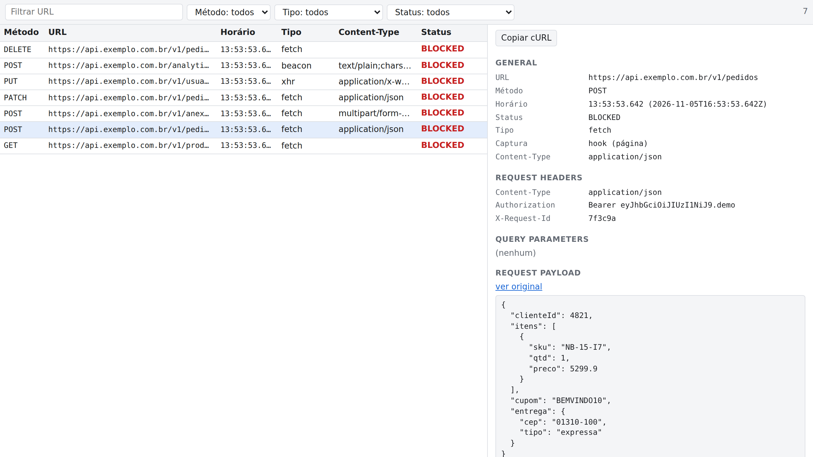
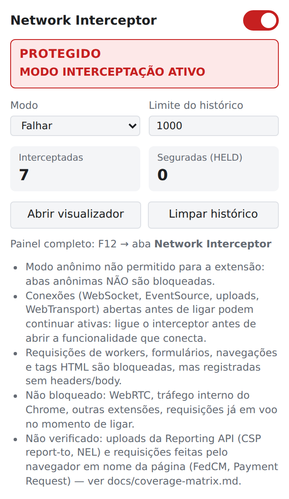
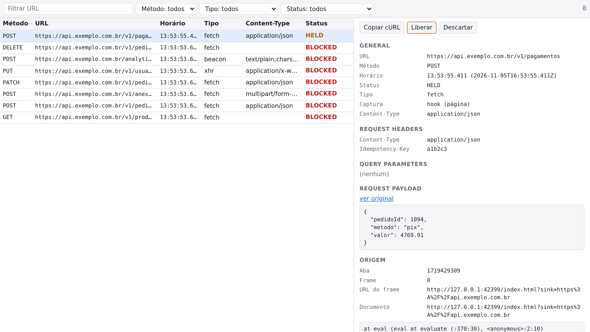
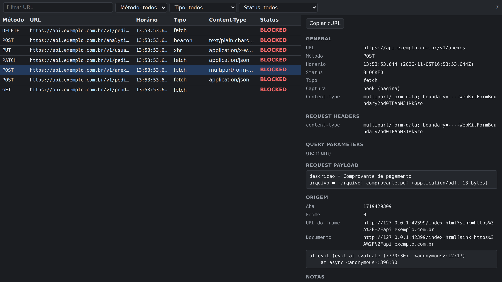

# NoSend — Network Interceptor

[](LICENSE)


Extensão para Chrome que **impede as requisições de uma página de saírem do navegador** e mostra exatamente o que teria sido enviado: URL, método, headers, query e payload, numa visualização parecida com a aba Network do DevTools.

Útil para inspecionar formulários, checkouts, integrações e analytics **sem tocar no servidor**: nada é criado, cobrado, enviado por e-mail ou registrado do outro lado.



## Destaques

- **Bloqueio de verdade, não só observação.** As requisições são barradas na pilha de rede do Chrome (`declarativeNetRequest`), antes de qualquer conexão. Os testes automatizados provam que o servidor recebe **zero conexões TCP**.
- **Captura fiel.** `fetch`, XHR, `sendBeacon`, WebSocket e EventSource são registrados com headers e body, incluindo o `Content-Type` que o navegador acrescentaria. JSON, `x-www-form-urlencoded` e multipart são exibidos interpretados.
- **A aplicação vê uma falha de rede comum.** `fetch` rejeita, XHR dispara `error`, `sendBeacon` retorna `false`. Nunca há resposta falsa.
- **Modo Segurar.** A requisição fica pendente, e você decide **Liberar** (enviada uma única vez) ou **Descartar**.
- **Status à prova de engano.** O status só mostra **PROTEGIDO** depois de verificar que o bloqueio está ativo; caso contrário, mostra **PROTEÇÃO INCOMPLETA** com os motivos.
- **Copiar como cURL**, seguro para colar no terminal.
- **100% local.** Sem analytics, sem chamadas externas.

## Prints

| Popup | Modo Segurar |
|---|---|
|  |  |

Tema escuro, com um upload multipart interpretado:



## Instalação

Requisitos: **Node.js 24+** e **Google Chrome/Chromium 121+** (desenvolvido e testado com o Chrome 155).

```bash
git clone https://github.com/Rayan-Aguiar/NoSend.git
cd NoSend
npm ci
npm run build        # gera dist/
```

1. Abra `chrome://extensions` e ative o **Modo do desenvolvedor**.
2. Clique em **Carregar sem compactação** e escolha a pasta `dist/`.
3. *(Recomendado)* Em **Detalhes**, ative **Permitir no modo anônimo**. Sem isso, as abas anônimas **não são bloqueadas**, e a extensão avisa enquanto a permissão estiver desligada.

A extensão precisa ser carregada **descompactada**: a captura pela camada de rede (`onRuleMatchedDebug`) e a verificação do bloqueio (`testMatchOutcome`) só existem nesse modo. Depois de um novo build, use o botão de recarregar em `chrome://extensions`; as abas abertas recebem os hooks automaticamente.

## Como usar

1. Com a extensão **desligada**, abra a aplicação e chegue à tela que interessa (login, navegação etc.).
2. **Ligue** pelo popup. O status deve ficar **PROTEGIDO**.
3. Use a aplicação normalmente. Cada requisição é bloqueada e aparece no histórico.
4. Veja os detalhes no **visualizador** (botão no popup) ou no **DevTools** (F12 → aba **Network Interceptor**).

> [!IMPORTANT]
> Com a extensão ligada, **navegações também são bloqueadas**: recarregar a página, abrir uma URL nova ou enviar um `<form>` tradicional falha. A navegação também é uma requisição. Para recarregar, desligue, recarregue e ligue de novo.

> [!TIP]
> Ligue **antes** de abrir a funcionalidade que conecta. WebSocket, EventSource e uploads já abertos antes de ligar podem continuar ativos.

### Status

| Status | Significado |
|---|---|
| **DESLIGADO** | Nada é bloqueado nem registrado. |
| **ATIVANDO** | Instalando e verificando o bloqueio. |
| **PROTEGIDO** | Regra de bloqueio presente e conferida, bloqueio confirmado para todos os tipos de recurso e predição de rede do Chrome desligada (ela abriria conexões antecipadas). |
| **PROTEÇÃO INCOMPLETA** | Ligado, mas alguma verificação falhou. Os motivos aparecem no popup. **Não confie no bloqueio.** |

O popup também mostra avisos permanentes sobre o que não é coberto e, quando for o caso, avisa que a aba atual está com **captura reduzida** (sem headers/body).

### Modos

**Falhar** (padrão): a requisição é registrada como `BLOCKED` e a aplicação recebe uma falha de rede.

**Segurar**: `fetch`, XHR assíncrono e `sendBeacon` ficam `HELD`, e a aplicação continua esperando (o loading continua na tela). Para cada requisição:

- **Liberar:** uma exceção estreita e temporária é aberta e a requisição original é enviada **uma vez**; a aplicação recebe a resposta real (`RELEASED`).
- **Descartar:** a aplicação recebe a falha de rede e nada é enviado (`DISCARDED`).
- Se a aba fechar ou trocar de página, as requisições seguradas dela viram `DISCARDED_PAGE_GONE`. Se saírem do histórico (limite ou **Limpar**), são descartadas.

WebSocket, EventSource e XHR síncrono não podem ser segurados e falham na hora. A liberação falha de forma limpa quando há redirect ou service worker no caminho (detalhes em [docs/blocking.md](docs/blocking.md#regra-de-liberação-e-seus-riscos)).

### Visualização

- **Popup:** liga/desliga, status, modo, limite do histórico (100–10000, padrão 1000), contadores e avisos.
- **Visualizador:** todos os registros de todas as abas.
- **Painel do DevTools:** os mesmos registros, filtrados pela aba inspecionada.
- **Lista:** filtros por URL, método, tipo e status.
- **Detalhe:** General, Request Headers, Query Parameters, Request Payload (interpretado ou original), origem (aba, frame, stack) e notas.
- **Ações:** **Copiar cURL**; **Liberar** e **Descartar** em requisições seguradas.

O cURL é seguro para colar no shell: valores com caracteres especiais são escapados, e campos de arquivo nunca usam o nome vindo da página (saem como `@ARQUIVO_AQUI`, com um comentário indicando o arquivo original). Copiar só põe texto na área de transferência; nada é executado.

## O que é coberto

| Coberto com captura completa | Bloqueado, mas registrado só com URL/método/tipo | Não bloqueado |
|---|---|---|
| `fetch`, XHR, `sendBeacon`, WebSocket (abertura e mensagens), EventSource | Navegações, `<form>` tradicional, ``, CSS, scripts, iframes, workers e service workers, prefetch/preload | WebRTC, tráfego interno do Chrome, outras extensões, requisições já em andamento no momento de ligar |

Detalhes por API, incluindo os itens **não verificados** (Reporting API, FedCM, Payment Request), estão na [matriz de cobertura](docs/coverage-matrix.md).

## Como funciona

```
página ──► hooks (fetch/XHR/beacon/WS/SSE) ──► registram o que seria enviado e devolvem falha de rede
   │
   └──► pilha de rede do Chrome ──► regra declarativeNetRequest bloqueia tudo (inclusive o que escapar dos hooks)
                                    predição de rede desligada (sem conexões antecipadas)
```

Duas camadas independentes: os **hooks** dão fidelidade (headers e body); o **DNR** dá a garantia (bloqueio mesmo se um hook falhar ou for contornado). A arquitetura completa está em [docs/architecture.md](docs/architecture.md).

## Desenvolvimento

| Script | O que faz |
|---|---|
| `npm run build` | Build de produção em `dist/`. |
| `npm run build:test` | Build de teste em `dist-test/` (com ganchos de teste; **nunca use para uso real**). |
| `npm run typecheck` | `tsc --noEmit`. |
| `npm test` | Build de teste + suíte completa (unitários e e2e). |
| `npm run test:unit` | Só os unitários. |
| `npm run test-app` | Sobe a app de teste e o servidor que registra cada conexão, para testar à mão. |
| `npm run screenshots` | Regera os prints deste README a partir do build de produção. |

### Testes

Os testes e2e carregam a extensão num Chromium com perfil temporário e sobem dois servidores locais: uma **app de teste** e um **sink**, que recebe as requisições e conta **cada conexão TCP**. Com a extensão ligada, a verificação central de todos os cenários é `sink.connections === 0`; com ela desligada, os mesmos cenários precisam chegar ao servidor intactos.

- `CHROME_PATH`: executável do Chrome/Chromium (padrão: Chromium do cache do Playwright, `chromium-1247`).
- `HEADED=1`: abre o navegador visível.
- `NI_OUT`: pasta do build de teste (útil para rodar suítes em paralelo).

O Chrome precisa conseguir iniciar na máquina; em sandboxes que bloqueiam sockets Unix, os testes de navegador não sobem.

### Teste manual

```bash
npm run test-app
```

Abre a app de teste e mostra no terminal, ao vivo, toda conexão, requisição e frame WebSocket que chega ao servidor. Abra a URL impressa com a extensão desligada, ligue-a e clique nos cenários: com ela ligada, **nada deve aparecer no terminal**. Clique em `prepareWorker` e `registerSw` **antes** de ligar, porque com a extensão ligada a própria app também é bloqueada.

## Privacidade

- O histórico pode conter **tokens, senhas e dados pessoais**: é exatamente o que a aplicação tentou enviar. Ele fica **sem criptografia** no perfil do Chrome até ser limpo. Use **Limpar histórico** ao terminar e evite perfis compartilhados.
- Registros de abas anônimas ficam **só em memória**; na dúvida sobre a origem, o registro é tratado como anônimo.
- A extensão **não faz nenhuma chamada de rede**: sem analytics, sem fontes ou CDNs externos.

## Limitações conhecidas

- **Histórico grande:** a cada mudança a lista inteira é reenviada à interface e regravada. Com limite perto de 10000 e bodies grandes, pode ficar lento (o padrão de 1000 e o teto de 1 MB por body seguram isso).
- **Não verificados:** relatórios da Reporting API (CSP `report-to`, NEL) e buscas feitas pelo navegador em nome da página (FedCM, Payment Request).
- **Painel do DevTools** testado só à mão (usa o mesmo componente do visualizador, que é testado).
- **Modo Segurar:** XHR síncrono não pode ser segurado, e um `fetch` segurado ignora `AbortSignal` (use Descartar).

## Documentação

- [Arquitetura](docs/architecture.md): camadas, mensagens, toggle, status, armazenamento e build.
- [Mecanismos de bloqueio](docs/blocking.md): semântica de falha por API, regra de liberação e resultados dos experimentos.
- [Matriz de cobertura](docs/coverage-matrix.md): o que é bloqueado, como, o que é capturado e qual teste prova.
- [Documento de design](docs/superpowers/specs/2026-11-05-network-interceptor-design.md).

## Licença

[MIT](LICENSE) © 2026 Rayan Aguiar
