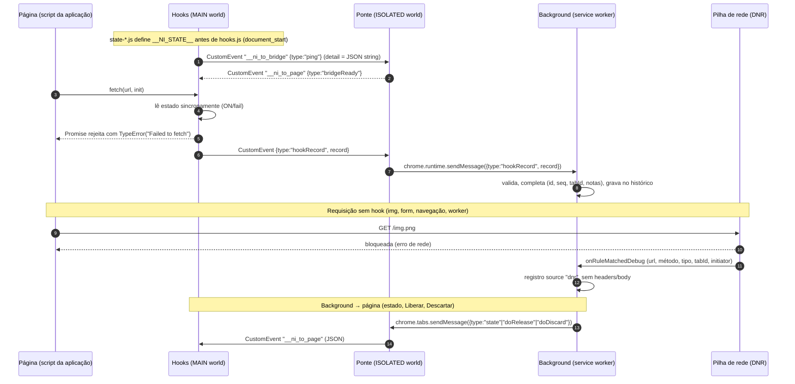

# Arquitetura

Visão para mantenedores. Spec de referência: [`superpowers/specs/2026-11-05-network-interceptor-design.md`](superpowers/specs/2026-11-05-network-interceptor-design.md) (citada como §N). Mecanismos de bloqueio em detalhe: [blocking.md](blocking.md).

## Camadas

| Camada (§3.1) | Mecanismo | Arquivos |
|---|---|---|
| **Bloqueio (garantia)** | Regra dinâmica DNR `block`, todos os `resourceTypes` | `src/background/dnr.ts` (`installBlockRule`, `verifyBlockRule`, `ALL_RESOURCE_TYPES`) |
| **Endurecimento** | `chrome.privacy.network.networkPredictionEnabled = false` enquanto ON | `src/background/privacy.ts` |
| **Captura rica + semântica** | Content scripts MAIN world (hooks de `fetch`, XHR, `sendBeacon`, `WebSocket`, `EventSource`) | `src/content/hooks/index.ts` (instalação, estado, fila), `fetch.ts`, `xhr.ts`, `beacon.ts`, `websocket.ts`, `eventsource.ts`, `common.ts` (disfarce, normalização, `emitRecord`), `ctx.ts` (contrato `HookCtx`) |
| **Estado síncrono** | Scripts `state-off.js` / `state-on-fail.js` / `state-on-hold.js` gerados pelo build | `build.mjs` (gera os 3 arquivos), `src/background/injection.ts` (registro e injeção) |
| **Ponte** | Content script ISOLATED world | `src/content/bridge.ts` |
| **Captura de fallback** | `declarativeNetRequest.onRuleMatchedDebug` | `src/background/dnrlog.ts` |
| **Liberar / Descartar** | Regra DNR de sessão `allow` + mensagens para a aba | `src/background/release.ts`, `src/background/dnr.ts` (`addAllowRule`), `src/shared/regex.ts` |
| **Estado / armazenamento** | Service worker + `chrome.storage.local` | `src/background/index.ts` (roteamento, toggle, badge), `state.ts` (configurações), `status.ts` (status fail-safe), `history.ts` (ring buffer + persistência) |
| **Compartilhado** | Tipos, mensagens, serialização de body, cURL, ring buffer | `src/shared/types.ts`, `messages.ts`, `body.ts`, `curl.ts`, `ring.ts`, `regex.ts` |
| **Visualização** | Popup, painel DevTools, `viewer.html` | `src/popup/popup.ts`, `src/devtools/devtools.ts`, `src/devtools/panel.ts`, `src/viewer/viewer.ts`, `src/ui/list-detail.ts`, `static/*.html`, `static/ui.css` |

TODO(UI): confirmar os caminhos dos arquivos de UI e o port `ni-ui` (`UI_PORT` em `src/shared/messages.ts`) depois do commit da Task 9. No estado atual, `onHistoryChange` em `src/background/index.ts` ainda é um stub ("UI ao vivo: Task 9").

Manifest (`static/manifest.json`): permissões `declarativeNetRequest`, `declarativeNetRequestFeedback`, `storage`, `privacy`, `scripting`, `tabs`, `webNavigation`, `unlimitedStorage`; `host_permissions: <all_urls>`; `incognito: "spanning"`; background como módulo ES. Os content scripts **não** estão no manifest: são registrados dinamicamente (ver "Estado síncrono").

## Fluxo de mensagens

Detalhes:

- Entre MAIN e ISOLATED os eventos carregam **JSON string** em `detail` (objetos não atravessam mundos de forma confiável). Nomes: `EV_TO_BRIDGE = '__ni_to_bridge'`, `EV_TO_PAGE = '__ni_to_page'` (`src/shared/messages.ts`).
- Os hooks capturam `dispatchEvent`, `addEventListener`, `CustomEvent`, `JSON.stringify/parse` **antes** de instalar qualquer patch, para não chamarem versões já interceptadas pela página.
- **Fila até a ponte**: registros emitidos antes de a ponte responder `bridgeReady` ficam em fila no MAIN world e são enviados quando ela responde. Isso cobre a requisição disparada pelo primeiro `<script>` inline da página (teste `http-scenarios.spec.ts › request fired by first inline script is blocked and recorded`). O bloqueio não depende da fila: o hook já falhou a requisição sincronamente.
- Mensagens para o background (`BgRequest`): `getState`, `setEnabled`, `setMode`, `setLimit`, `getRecords`, `clear`, `hookRecord`, `heldOutcome`, `release`, `discard`, `hookHeartbeat`. Background → aba (`TabMessage`): `state`, `doRelease`, `doDiscard`.
- **A página pode forjar eventos** `__ni_to_bridge`. O background valida o formato (`validHookRecord`) antes de gravar, mas uma página hostil consegue inserir registros falsos no histórico ou reportar `heldOutcome` falso. Isso não afeta o bloqueio (DNR), só a fidelidade do histórico.
- Uma ponte de uma instância anterior da extensão (extensão recarregada) fica inerte (`__NI_BRIDGE_ALIVE__` checa `chrome.runtime.id`); a nova ponte assume.
- Heartbeat: ao instalar, os hooks enviam `heartbeat` → `hookHeartbeat`; o background guarda `hookedTabs` (exposto em `getState`) para a UI distinguir abas com captura completa de abas "bloqueando, captura reduzida".

## Estado síncrono nos hooks (§3.3)

Problema: um `fetch` no primeiro script da página não pode esperar uma ida ao background para saber se está ON.

Mecanismo implementado:

1. O build gera três scripts minúsculos (`build.mjs`): `state-off.js`, `state-on-fail.js`, `state-on-hold.js`. Cada um faz `globalThis.__NI_STATE__ = {enabled, mode}` e, se os hooks já existirem, chama `globalThis.__NI_APPLY_STATE__(s)`.
2. O background registra com `chrome.scripting.registerContentScripts` (`src/background/injection.ts`, `syncContentScripts`), nesta ordem: `ni-state` (o `state-*.js` atual, MAIN), `ni-hooks` (`hooks.js`, MAIN), `ni-bridge` (`bridge.js`, ISOLATED). Todos com `matches: <all_urls>`, `allFrames`, `matchOriginAsFallback` (cobre `about:blank`, `srcdoc`, `blob:`/`data:`), `runAt: document_start`, `persistAcrossSessions`. O spike confirmou que scripts MAIN registrados rodam na ordem de registro.
3. Ao mudar o estado, só `ni-state` é atualizado (`updateContentScripts` trocando o arquivo) — novos documentos já nascem com o estado certo.
4. Documentos já abertos recebem o estado de duas formas:
   - **broadcast**: `chrome.tabs.sendMessage({type:'state'})` para todas as abas; a ponte repassa ao MAIN world, que chama `applyState`.
   - **`executeScript`** em todas as abas `http(s)`/`file` (`injectIntoOpenTabs`, `allFrames`, `injectImmediately`): reinjeta `state-*.js`, `hooks.js` e `bridge.js`. Os scripts são idempotentes (`__NI_INSTALLED__`, `__NI_BRIDGE_ALIVE__`); a reexecução do script de estado chama `__NI_APPLY_STATE__`. Isso também cobre abas abertas antes da instalação (feito também em `runtime.onInstalled`). Abas onde a injeção falha (`chrome://`, Web Store, outras extensões) ficam só com o DNR.
5. **Fail-safe**: se os hooks rodarem sem `__NI_STATE__` válido, assumem `{enabled: true, mode: 'fail'}` (`FAILSAFE` em `src/content/hooks/index.ts`). Teste: `injection.spec.ts › missing state defaults to ON`.

Quando o estado muda para ON, os hooks de WebSocket/EventSource fecham conexões abertas enquanto OFF (`onStateChange`), ver [blocking.md](blocking.md#conexões-abertas-antes-do-on).

## Ligar / desligar

`src/background/index.ts`:

- **Serialização**: `getState`, `setEnabled`, `setMode` e `setLimit` passam por uma cadeia de promessas (`serial`), então toggles e leituras de estado nunca se intercalam. Teste: `background.spec.ts › rapid toggle ON/OFF/ON ends PROTECTED with rule present`.
- **Ligar** (`enable`):
  1. Salva `enabled: true` **antes** de qualquer outra coisa — se o service worker morrer no meio, a inicialização seguinte reaplica a regra (direção fail-safe).
  2. Status `ATIVANDO`.
  3. Instala a regra DNR de bloqueio.
  4. Desliga a predição de rede.
  5. Recalcula o status (erros de 3–4 entram como motivos).
  6. Propaga o estado às páginas (`applyPageState`: re-registro, broadcast, injeção).
- **Desligar** (`disable`): remove a regra DNR → restaura a predição (`clear()`) → salva `enabled: false` → status `DESLIGADO` → propaga às páginas. Na janela entre remover a regra e atualizar as páginas, os hooks ainda estão ON e continuam falhando as requisições: o erro é sempre para o lado do bloqueio.
- **Modo** (`setMode`): salva e propaga às páginas (troca o `state-*.js`).
- **Inicialização** (todo wake-up do service worker, promessa `ready`): carrega configurações e histórico, remove regras `allow` órfãs, e se `enabled` reinstala regra e privacy, recalcula status e re-registra content scripts. Todas as mensagens esperam `ready`. Teste: `background.spec.ts › ON survives browser restart`.

Requisições `HELD` existentes ao desligar permanecem `HELD`.

## Status de proteção

`src/background/status.ts` (`computeStatus`). Com ON, `PROTEGIDO` só se **as três** verificações passarem e não houver erro de ativação:

1. **Regra presente e idêntica** (`verifyBlockRule`): `getDynamicRules()` contém a regra id 1, ação `block`, com todos os 15 `resourceTypes` e sem nenhuma condição restritiva (`urlFilter`, `regexFilter`, `requestDomains`, `initiatorDomains`, `requestMethods`, `tabIds`, `domainType`).
2. **Matcher confirma** (`verifyBlockRule`): `testMatchOutcome` para cada tipo × URLs de amostra (`http`/`https`; `ws`/`wss` para `websocket`) retorna a regra 1 do ruleset `_dynamic`. Se `testMatchOutcome` não existir (extensão não descompactada), o status é incompleto.
3. **Predição de rede** (`verifyPrediction`): `networkPredictionEnabled` com `value: false` e `levelOfControl: controlled_by_this_extension` (uma política corporativa que controla a configuração derruba o status).

Qualquer falha → `PROTEÇÃO INCOMPLETA` com a lista de motivos; exceção na verificação também vira motivo. O status é recalculado ao ligar, a cada wake-up do service worker e em todo `getState` (popup/painel). Avisos permanentes (não rebaixam o status): acesso a modo anônimo desligado.

Badge: `ON` vermelho (protegido), `!` laranja (incompleto), `…` laranja (ativando), vazio (desligado).

Testes: `background.spec.ts › enable → PROTECTED`, `forced DNR failure → INCOMPLETE`, `rule removed externally → INCOMPLETE on getState`, `disable → OFF, rule removed, prediction restored`.

Observação: a verificação 3 consulta o escopo regular. No escopo anônimo a predição é desligada (`incognito_session_only`) quando há permissão de modo anônimo, mas isso não é verificado separadamente.

## Armazenamento e histórico

`src/background/history.ts`, `src/shared/ring.ts`:

- Ring buffer em memória, limite configurável (padrão 1000, faixa 100–10000, `clampLimit`), descarta os mais antigos; ordem por `seq` monotônico global.
- Persistência em `chrome.storage.local` (`ni_history`, `ni_seq`) com debounce de 300 ms; recarregada a cada wake-up do service worker. Configurações em `ni_settings`.
- Permissão `unlimitedStorage`: 10000 registros com bodies (até 1 MB de texto cada) estourariam a cota padrão de 10 MB.
- **Modo anônimo**: registros de abas anônimas (`incognito: true`) ficam só em memória — filtrados na gravação. Somem quando o service worker reinicia ou o histórico é limpo.
- Limpar apaga memória e storage.
- Corpo: texto acima de 1 MB truncado com tamanho original; binário vira `{size, mime, previewHex}` (primeiros 64 bytes); `ReadableStream` não é lido (`src/shared/body.ts`).
- O objeto original (body real, `Request`, XHR) usado para Liberar fica só na memória da página; nunca vai ao background.

## Liberar / Descartar

`src/background/release.ts`. Resumo (riscos em [blocking.md](blocking.md#regra-de-liberação-e-seus-riscos)):

1. Valida: registro `HELD`, `source: 'hook'`, com `hookId`, URL dentro do limite de regex (`canRelease`), aba conhecida.
2. Instala regra **de sessão** `allow`, prioridade 2, `tabIds:[tabId]`, `regexFilter` exato e ancorado (sem `#fragmento`), `requestMethods:[método, "options"]`, `resourceTypes:["xmlhttprequest","ping"]`.
3. Envia `doRelease` ao frame de origem; o hook chama a API nativa com os argumentos originais. Se a aba/frame não responde, a regra é removida e o registro vira `DISCARDED_PAGE_GONE`.
4. A regra é removida no **primeiro `onRuleMatchedDebug` do ruleset `_session` com o método original** (o preflight `OPTIONS` não a remove) ou após **10 s**, o que vier primeiro. Não se espera o `heldOutcome` do hook porque o `sendBeacon` retorna antes de a requisição chegar à rede.
5. O hook reporta o resultado real (`heldOutcome`) → `releaseResult` no registro.
6. Na inicialização do service worker todas as regras `allow` (ids ≥ 1000) são removidas.

Descartar: `doDiscard` → o hook falha a requisição como no modo Falhar → `DISCARDED`. `tabs.onRemoved` e `webNavigation.onCommitted` marcam os `HELD` da aba/frame como `DISCARDED_PAGE_GONE`.

## Build

`build.mjs` (esbuild):

| Entrada | Saída | Formato |
|---|---|---|
| `src/background/index.ts` | `background.js` | ESM (service worker módulo) |
| `src/content/hooks/index.ts` | `hooks.js` | IIFE |
| `src/content/bridge.ts` | `bridge.js` | IIFE |
| `src/popup/popup.ts` | `popup.js` | IIFE |
| `src/devtools/devtools.ts` | `devtools.js` | IIFE |
| `src/devtools/panel.ts` | `panel.js` | IIFE |
| `src/viewer/viewer.ts` | `viewer.js` | IIFE |

Entradas inexistentes são ignoradas. `static/` é copiado inteiro; os três `state-*.js` são gerados. Alvo `chrome120`.

- `node build.mjs` → `dist/`, `define: { __TEST__: 'false' }`. O código de teste (flag `__test_force_dnr_failure` em `installBlockRule`, `niDebug.addRecord/flush/reloadFromStorage`, `__NI_DEBUG_GETSTATE__`) é eliminado como código morto.
- `node build.mjs --test` → `dist-test/`, `__TEST__ = true`, e copia `test/ext-fixtures/` para `dist-test/test-fixtures/` (scripts do spike).
- `NI_OUT` sobrescreve a pasta de saída (os testes leem a mesma variável em `test/fixtures.ts`).
- `niDebug.handle` existe nos dois builds (`globalThis.niDebug` no service worker); só é acessível a quem já tem acesso ao contexto do service worker da extensão.

Verificação de que o build de produção não contém a flag: `grep -r __test_force dist/` deve ser vazio.

## Testes

- `playwright.config.ts`: projetos `unit` (`test/unit`) e `e2e` (`test/e2e`, 1 worker, em série).
- `test/fixtures.ts`: `launchPersistentContext` com `--load-extension` em perfil temporário, `CHROME_PATH`, `HEADED`, `NI_OUT`; fixtures `ext` (chama `niDebug.handle` no service worker), `sink`, `app`, `openApp`, `run` (executa `window.scenarios[nome]` da app).
- `test/servers/sink.ts`: servidor HTTP em porta 0 que conta **cada conexão TCP**, cada requisição (com body), upgrades WebSocket (handshake manual, eco) e frames; endpoints `/sse` e `/redirect`. Os testes leem os contadores em processo (não há API HTTP de consulta, então consultar o sink nunca gera conexão).
- `test/servers/app.ts` + `test/app/`: app de teste em outra origem, com os cenários em `window.scenarios` (também como botões).
- `test/manual.ts`: `npm run test-app`.
